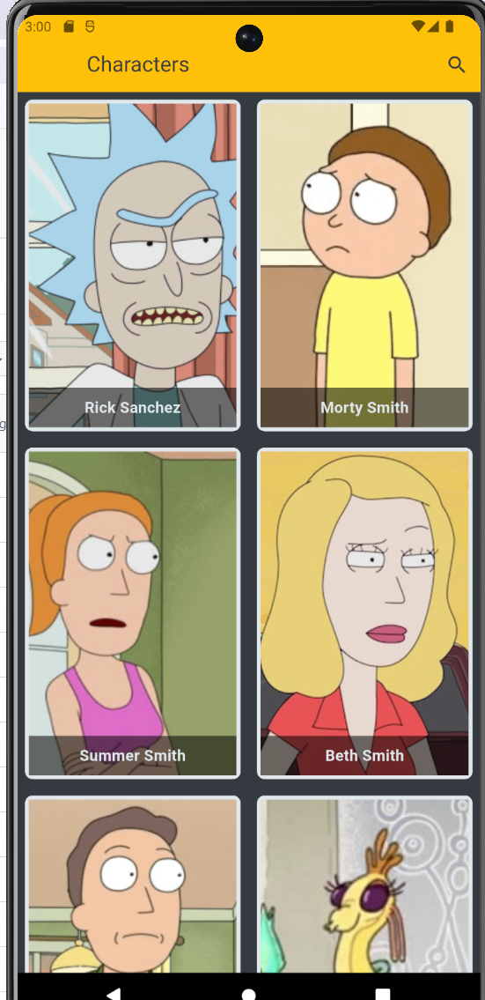
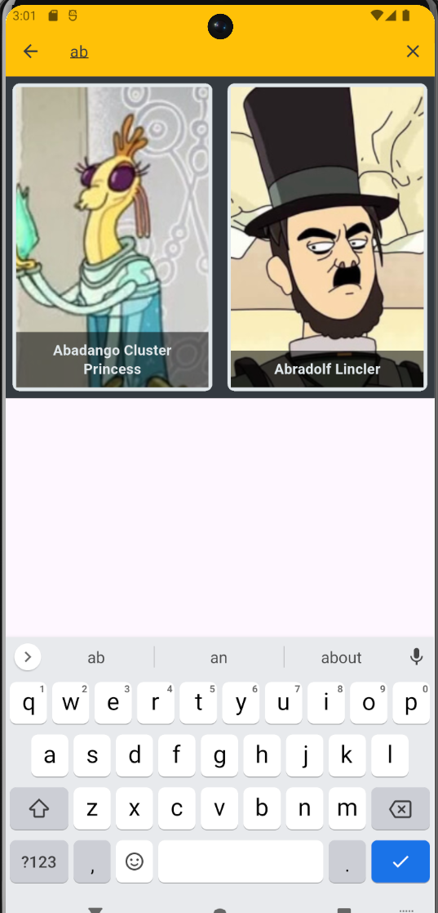
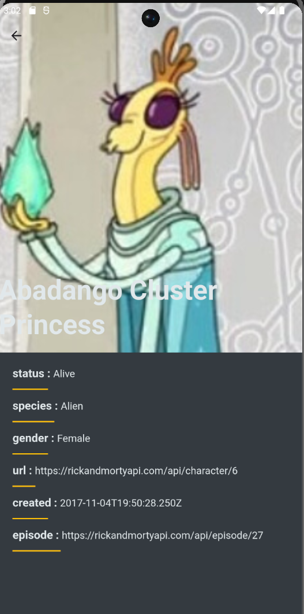

# 🎬 Cartoon Characters Explorer

A modern Flutter mobile application designed to explore cartoon characters using a REST API. The app features instant character search capabilities and detailed profile views, with state management powered by BLoC/Cubit.

---

## 📱 App Screenshots

  
  
  

---

## 📌 Features

* **Character Directory:** Browse a dynamic list of cartoon characters with high-quality images and basic details.
* **Instant Character Search:** Filter and search characters live by letter with fast and seamless UI updates.
* **Detailed Character Views:** Tap on any character to view their comprehensive details and background information fetched from the API.
* **Smooth State Handling:** Clean transitions for loading, success, and error states.

---

## 🔗 API Reference

This application fetches character data from the following API:
* **API Documentation:** [Rick and Morty API](https://rickandmortyapi.com/documentation)

---

## 🛠️ Tech Stack & Architecture

* **Framework:** Flutter (Dart)
* **State Management:** BLoC / Cubit
* **API Integration:** REST API (HTTP )
* **Architecture Pattern:** Clean Architecture / MVVM

---

## 👩‍💻 Key Technical Highlights

* Managed complex app states (Loading, Success, Empty, Error) predictably using **BLoC/Cubit**.
* Implemented live filtering search logic to filter characters efficiently based on input query.
* Parsed JSON responses from the API into strongly-typed Dart models.
* Designed responsive and clean UI components for optimum user experience across devices.
